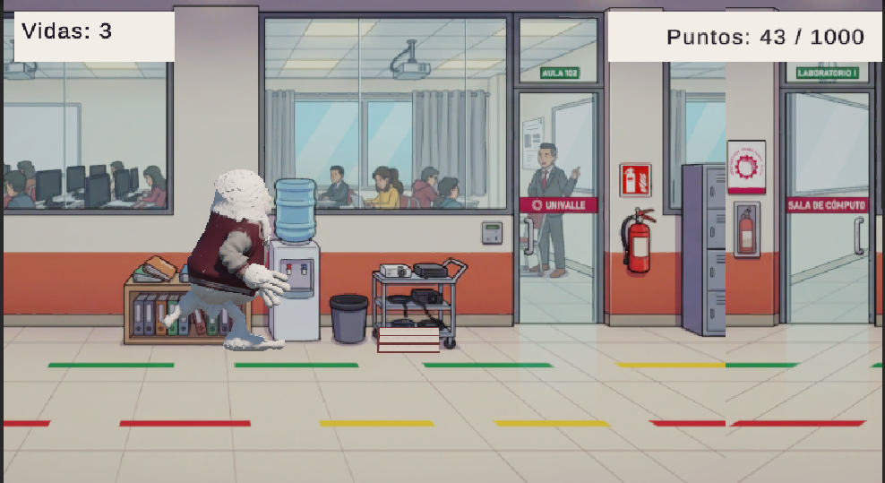

 

&nbsp;

**ARCADE · ENDLESS RUNNER 3D · AMBIENTACIÓN UNIVERSITARIA**

*Salta, agáchate y llega a tiempo a tu defensa de Game Development.*

## Explora el campus

**[01 · Historia](#historia)** &nbsp; / &nbsp; **[02 · Personaje](#personaje)** &nbsp; / &nbsp; **[03 · Controles](#controles)** &nbsp; / &nbsp; **[04 · Datos](#datos)** &nbsp; / &nbsp; **[05 · Jugar](#jugar)**

[El portal web](#el-portal-web) · [Desarrollo](#desarrollo) · [Créditos](#créditos)

---

## Historia

### 01 / La clase no va a esperar

El protagonista es un estudiante tranquilo, confiado y algo distraído. Al llegar al campus descubre que quedan pocos minutos para su defensa de Game Development. Debe atravesar los pasillos y llegar al laboratorio a tiempo.

El recorrido está lleno de mochilas olvidadas, pilas de libros y letreros suspendidos. La velocidad aumenta y los obstáculos aparecen de forma aleatoria: cada intento propone una carrera diferente.

> **La misión:** alcanzar 1000 puntos conservando al menos una vida.

*Señalética, aulas y objetos cotidianos forman parte del desafío.*

[Volver a la navegación ↑](#explora-el-campus)

---

## Personaje

### 02 / Un estudiante fuera de lo común

Su pelaje blanco, su gran tamaño y su chaqueta guinda y gris lo distinguen en el campus. Su apariencia tranquila contrasta con los reflejos necesarios para superar el recorrido.

**EL YETI UNIVERSITARIO**  
Protagonista · Modelo 3D · Cuatro animaciones

| Estado | Función en la partida |
| :--- | :--- |
| **Correr** | Mantener el recorrido automático |
| **Saltar** | Superar obstáculos bajos |
| **Agacharse** | Pasar bajo los letreros reduciendo el área de colisión |
| **Morir** | Mostrar la caída al perder todas las vidas |

[Volver a la navegación ↑](#explora-el-campus)

---

## Controles

### 03 / Dos teclas y reflejos atentos

El recorrido avanza automáticamente. El jugador decide cuándo saltar y cuándo agacharse.

| Entrada | Acción | Cuándo utilizarla |
| :---: | :--- | :--- |
| <kbd>↑</kbd> | **Saltar** | Ante libros y mochilas |
| <kbd>↓</kbd> | **Agacharse** | Bajo carteles suspendidos |
| **Clic** | **Interactuar** | Menús, sonido y reinicio |

**Haz clic dentro del juego antes de utilizar las flechas.**

### Reglas del recorrido

- Comienzas con **3 vidas**.
- Cada obstáculo que impacta al personaje resta **1 vida**.
- El puntaje aumenta mientras sobrevives.
- La selección y los intervalos de aparición de obstáculos son aleatorios.
- La velocidad aumenta y los intervalos entre obstáculos se reducen progresivamente.
- Los obstáculos superados se eliminan fuera de la vista.

| Resultado | Condición |
| :--- | :--- |
| **Victoria** | Alcanzar 1000 puntos |
| **Fin de la partida** | Perder todas las vidas |
| **Nuevo intento** | Pulsar «Volver a jugar» al terminar |

[Volver a la navegación ↑](#explora-el-campus)

---

## Datos

### 04 / El desafío en números

| Aspecto | Descripción |
| :--- | :--- |
| **Género** | Arcade / Endless Runner |
| **Ambientación** | Campus universitario |
| **Obstáculos** | Libros, mochilas y carteles |
| **Dificultad** | Progresiva |
| **Puntaje** | Basado en el tiempo de supervivencia |
| **Plataforma** | Navegador web |

**Inicio → Aceleración → Meta**  
Reconoce los obstáculos, adapta tus reflejos y conserva al menos una vida hasta alcanzar la puntuación objetivo.

[Volver a la navegación ↑](#explora-el-campus)

---

## Jugar

### 05 / Comienza tu carrera

  

1. Abre el juego en itch.io.
2. Pulsa **Run game** y espera a que termine la carga.
3. Selecciona **Jugar**.
4. Haz clic dentro del juego y utiliza las flechas.

<strong>Requisitos y recomendaciones de ejecución</strong>

- Computadora con teclado y ratón.
- Navegador actualizado compatible con WebGL 2.
- Conexión a internet para cargar el juego.
- No necesitas instalar Unity ni un ejecutable.
- Utiliza el botón de pantalla completa si deseas ampliar la vista.
- Si no escuchas audio, comprueba el botón de sonido, el volumen y el sonido de la pestaña.
- Esta versión no incluye controles táctiles para celular.

[Volver a la navegación ↑](#explora-el-campus)

---

## El portal web

La página reúne la historia, el personaje, las mecánicas, la infografía y el acceso directo a la compilación web. Su identidad utiliza guinda, crema y gris, con detalles inspirados en la señalética universitaria.

Incluye navegación por secciones, menú móvil, enlaces para jugar y distribución adaptable. **El portal se adapta al celular; la partida requiere teclado.**

## Desarrollo

| Tecnología | Uso |
| :--- | :--- |
| **Unity y C#** | Videojuego y lógica de partida |
| **Mixamo** | Animaciones del personaje |
| **HTML y CSS** | Estructura, identidad visual y diseño adaptable |
| **JavaScript** | Menú móvil y navegación |
| **GitHub Pages** | Publicación del portal |
| **itch.io** | Alojamiento del juego WebGL |

<strong>Explorar los archivos del repositorio</strong>

| Ruta | Contenido |
| :--- | :--- |
| `index.html` | Contenido y secciones del portal |
| `style.css` | Diseño y adaptación a diferentes pantallas |
| `script.js` | Interacciones de navegación |
| `assets/images/` | Capturas y personaje |
| `assets/readme/` | Cabecera, botones y métricas de este README |
| `README.md` | Presentación y documentación |

<strong>Abrir el portal en tu computadora</strong>

1. Descarga el repositorio con **Code → Download ZIP**.
2. Extrae el ZIP.
3. Abre `index.html` en el navegador.

También puedes abrir la carpeta en Visual Studio Code para editarla. El acceso al juego en itch.io requiere internet.

<strong>Actualizar el portal o el videojuego</strong>

**Portal:** modifica los archivos, comprueba los cambios y súbelos a la rama configurada en GitHub Pages. Revisa el despliegue en **Actions**.

**Videojuego:** realiza y prueba los cambios en Unity, genera una nueva compilación Web y actualiza su ZIP en itch.io.

## Créditos

**Videojuego:** Melani Quintela Aguilar y José Martin Leaño Mercado.  
**Portal web:** [Martín Leaño](https://github.com/martinleano72-afk).  
Proyecto académico de **Game Development**.

---

**EL CAMPUS TE ESPERA. LA DEFENSA TAMBIÉN.**

[Jugar ↗](https://katfipol.itch.io/yeti-enes-que-correr) · [Explorar el portal ↗](https://martinleano72-afk.github.io/yeti-portal/) · [Volver arriba ↑](#explora-el-campus)

